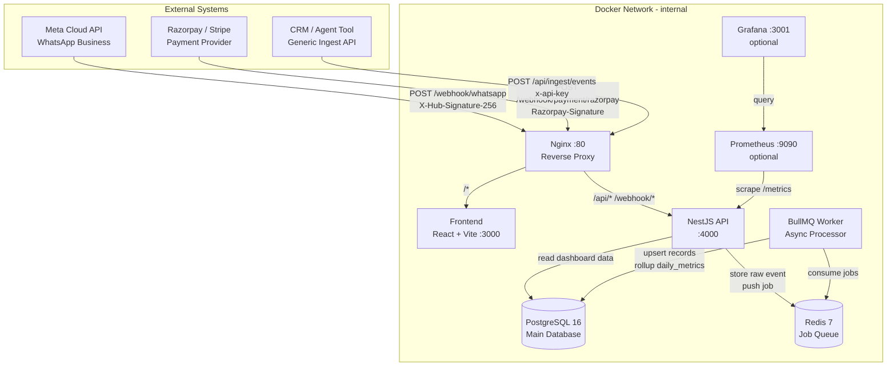

# WhatsApp Monitoring Dashboard

A fully containerized, read-only monitoring platform that ingests events from Meta Cloud API, payment providers, and a generic ingest API, then visualizes four key metrics on a premium dark React dashboard.

> **Read-only platform.** This application never sends messages, initiates payments, or interacts with customers. It is a pure monitoring and analytics layer.

---

## Architecture



---

## Quick Start

### Prerequisites
- Docker 24+ with Docker Compose v2
- Make (optional but recommended)
- An ngrok account for local webhook testing

### 1. Configure environment

```bash
cp .env.example .env
# Edit .env with your actual secrets
```

### 2. Start all services

```bash
make up
# or: docker compose up -d
```

### 3. Run database migrations

```bash
make migrate
# or: docker compose exec api npx prisma migrate deploy
```

### 4. Seed demo data

```bash
make seed
# Populates 30 days of realistic demo data
# Demo credentials: admin@demo.com / admin123
```

### 5. Open the dashboard

http://localhost

---

## Makefile Targets

| Target | Description |
|---|---|
| `make up` | Start all services |
| `make down` | Stop all services |
| `make build` | Rebuild all Docker images |
| `make logs` | Follow all service logs |
| `make logs-api` | Follow API + worker logs only |
| `make migrate` | Run Prisma migrations |
| `make seed` | Seed demo data |
| `make test` | Run unit tests |
| `make shell-api` | Shell into the API container |
| `make shell-db` | Open psql session |
| `make monitoring` | Start with Prometheus + Grafana |
| `make clean` | Remove all containers and volumes |

---

## Webhook Setup with ngrok

### 1. Install and start ngrok

```bash
ngrok http 80
# Note the HTTPS URL, e.g. https://abc123.ngrok.io
```

### 2. Configure WhatsApp webhook (Meta Developer Console)

1. Go to your Meta App → WhatsApp → Configuration
2. **Callback URL**: `https://abc123.ngrok.io/webhook/whatsapp`
3. **Verify Token**: Set this to the value of `WHATSAPP_VERIFY_TOKEN` in your `.env`
4. Subscribe to these fields: `messages`, `message_status`

Events ingested:
- `statuses[].status = sent|delivered|read|failed` → counted as **Messages Sent** + status updates
- `messages[]` (inbound customer messages) → counted as **Replies Received**

### 3. Configure Razorpay webhook

1. Go to Razorpay Dashboard → Settings → Webhooks
2. **URL**: `https://abc123.ngrok.io/webhook/payment/razorpay`
3. **Secret**: Set to the value of `RAZORPAY_WEBHOOK_SECRET` in your `.env`
4. Subscribe to: `payment_link.created`, `payment_link.paid`, `payment_link.expired`, `payment_link.cancelled`, `payment.captured`

### 4. Test webhooks manually

```bash
# WhatsApp verification
curl "http://localhost/webhook/whatsapp?hub.mode=subscribe&hub.verify_token=YOUR_TOKEN&hub.challenge=test123"

# Simulate inbound message
curl -X POST http://localhost/webhook/whatsapp \
  -H "Content-Type: application/json" \
  -d '{"object":"whatsapp_business_account","entry":[{"changes":[{"value":{"messages":[{"from":"919876543210","id":"wamid.test001","timestamp":"1700000000","type":"text","text":{"body":"Hello"}}]}}]}]}'

# Simulate payment captured
curl -X POST http://localhost/webhook/payment/razorpay \
  -H "Content-Type: application/json" \
  -d '{"event":"payment.captured","payload":{"payment":{"entity":{"id":"pay_test001","amount":50000,"currency":"INR","status":"captured"}}}}'
```

---

## Generic Ingest API

Push events from your CRM or agent tool directly.

### Authentication

All ingest endpoints require the `x-api-key` header:
```
x-api-key: your-ingest-api-key
```

### POST /api/ingest/events

Push one or more events:

```bash
# Single event
curl -X POST http://localhost/api/ingest/events \
  -H "Content-Type: application/json" \
  -H "x-api-key: your-api-key" \
  -d '{
    "type": "message_sent",
    "contact": "919876543210",
    "agent": "Rahul Kumar",
    "timestamp": "2024-01-15T10:30:00Z",
    "metadata": { "campaign": "festive_sale" }
  }'

# Batch events (array)
curl -X POST http://localhost/api/ingest/events \
  -H "Content-Type: application/json" \
  -H "x-api-key: your-api-key" \
  -d '[
    { "type": "payment_link_shared", "contact": "919876543210", "agent": "Priya Sharma", "reference": "plink_ABC123", "amount": 1500, "currency": "INR" },
    { "type": "payment_received", "contact": "919876543210", "reference": "plink_ABC123", "amount": 1500, "currency": "INR", "timestamp": "2024-01-15T11:00:00Z" }
  ]'
```

### Event Types

| type | Description | Required fields |
|---|---|---|
| `message_sent` | An outbound WhatsApp message was sent | — |
| `reply_received` | A customer replied to a message | — |
| `payment_link_shared` | A payment link was sent to a customer | `reference` |
| `payment_received` | A payment was completed | `reference`, `amount` |

### POST /api/ingest/csv

Upload historical data as a CSV file:

```bash
curl -X POST http://localhost/api/ingest/csv \
  -H "x-api-key: your-api-key" \
  -F "file=@events.csv"
```

CSV format:
```csv
type,contact,agent,timestamp,amount,currency,reference
message_sent,919876543210,Rahul Kumar,2024-01-01T09:00:00Z,,,
reply_received,919876543210,,2024-01-01T09:05:00Z,,,
payment_link_shared,919876543210,Rahul Kumar,2024-01-01T09:10:00Z,1500,INR,plink_ABC
payment_received,919876543210,,2024-01-01T10:00:00Z,1500,INR,plink_ABC
```

---

## Metric Definitions

All metrics are computed from `daily_metrics` (rolled up every 5 minutes from raw tables).

### Messages Sent
**Definition**: Count of outbound WhatsApp messages with at least a `sent` status event received.  
**Source**: `messages WHERE direction = 'OUTBOUND'`  
**Sub-metrics**:
- **Delivered**: messages that received a `delivered` status callback
- **Read**: messages that received a `read` status callback
- **Failed**: messages that received a `failed` status callback

### Replies Received
**Definition**: Count of inbound customer messages received on any monitored number.  
**Source**: `messages WHERE direction = 'INBOUND'`  
**Reply Rate**: `replies / messages_sent × 100%`

### Payment Links Shared
**Definition**: Count of payment links detected in outbound message bodies (via configurable regex) or pushed via the ingest API.  
**Detection patterns** (configurable via `PAYMENT_LINK_PATTERNS` env var):
- `rzp\.io` (Razorpay short URLs)
- `razorpay\.com/pl_` (Razorpay payment page)
- `pay\.cashfree\.com` (Cashfree)

### Payments Received
**Definition**: Count of payment_link.paid / payment.captured webhook events.  
**Amount**: Sum of `payments.amount` (stored in paise/smallest unit for Razorpay, divided by 100 for display).  
**Conversion Rate**: `payments_received / links_shared × 100%`

### Agent Performance
Grouped by `messages.agent_id`, joining `daily_metrics.agent_id`. Agents without an agent_id are grouped under "Unassigned".

---

## Data Model

```mermaid
erDiagram
    tenants ||--o{ users : has
    tenants ||--o{ contacts : has
    tenants ||--o{ agents : has
    tenants ||--o{ messages : has
    tenants ||--o{ payment_links : has
    tenants ||--o{ payments : has
    tenants ||--o{ webhook_events : has
    tenants ||--o{ daily_metrics : has

    messages }o--o| agents : sent_by
    messages }o--o| contacts : to
    messages ||--o| payment_links : triggers

    payment_links ||--o{ payments : receives

    daily_metrics }o--o| agents : for_agent
```

---

## Adding a New Payment Provider

Implement the `IPaymentProvider` interface in `api/src/worker/payment.processor.ts`:

```typescript
interface IPaymentProvider {
  name: string;
  // Extract a unique event ID from the webhook body
  extractEventId(body: any): string;
  // Parse the webhook body into a normalized payment event
  parseEvent(body: any): PaymentEvent | null;
}
```

Then add signature verification in `payment-webhook.controller.ts` switch statement.

---

## Optional Monitoring Stack (Prometheus + Grafana)

```bash
make monitoring
# or: docker compose -f docker-compose.yml -f docker-compose.monitoring.yml --profile monitoring up -d

# Access:
# Prometheus: http://localhost:9090
# Grafana:    http://localhost:3001  (admin / admin)
```

Import the pre-built Grafana dashboard from `monitoring/grafana-dashboard.json`.

---

## API Documentation

Full OpenAPI spec is available at:
- Swagger UI: http://localhost/api/docs
- Raw JSON: http://localhost/api/docs-json

---

## Environment Variables

| Variable | Description | Default |
|---|---|---|
| `DATABASE_URL` | PostgreSQL connection string | required |
| `REDIS_URL` | Redis connection string | required |
| `JWT_SECRET` | JWT signing secret (min 32 chars) | required |
| `JWT_REFRESH_SECRET` | JWT refresh secret | required |
| `JWT_EXPIRES_IN` | Access token expiry | `15m` |
| `WHATSAPP_APP_SECRET` | Meta app secret for signature validation | optional |
| `WHATSAPP_VERIFY_TOKEN` | Webhook verify token for Meta | required |
| `RAZORPAY_WEBHOOK_SECRET` | Razorpay webhook secret | optional |
| `STRIPE_WEBHOOK_SECRET` | Stripe webhook secret | optional |
| `CASHFREE_WEBHOOK_SECRET` | Cashfree webhook secret | optional |
| `INGEST_API_KEY` | Shared secret for generic ingest API | required |
| `PAYMENT_LINK_PATTERNS` | Pipe-separated regex patterns for link detection | `rzp\.io\|razorpay\.com/pl_` |
| `PROMETHEUS_ENABLED` | Enable Prometheus /metrics endpoint | `true` |
| `LOG_LEVEL` | Winston log level | `info` |

---

## Security Notes

- All secrets are read from environment variables only, never hardcoded
- Webhook signatures are validated using timing-safe comparison (`crypto.timingSafeEqual`)
- JWT tokens expire in 15 minutes (configurable)
- Rate limiting: 30 req/s per IP on API routes, 100 req/s on webhook routes
- Input validation via `class-validator` on all DTOs
- All containers run as non-root users
- Only Nginx port 80 is exposed; all other services are on an internal network

---

## Tests

```bash
make test
# or: docker compose exec api npm test
```

Test coverage:
- Webhook HMAC-SHA256 signature validation (valid/invalid/replay)
- WhatsApp event parsing (status updates, inbound messages, payment link detection)
- Rollup metric aggregation (messages sent, replies, links, payments)
- Dashboard KPI computation from daily_metrics
- Ingest API idempotency (duplicate event_id deduplication)
